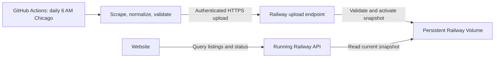

# Automated Refresh Reliability and Alerting

**Created: 2026-10-21**

**Status:** Reliability safeguards are implemented and verified locally, but have
not been deployed. The current local workflow still publishes data through Git
commits. The latest requirement is to update production data without daily
deployments; the [Railway Volume migration plan](#planned-migration-update-data-without-redeploying-railway)
below is documented only and has not been implemented.

## Purpose and user impact

Students use availability and prices to compare housing options. If refreshes stop,
they may spend time evaluating a listing that has already leased, miss newly
available listings, or see an outdated price when they follow the source link.
These are plausible consequences of stale data; no affected-user count or specific
user complaint has been established by this investigation.

The product's refresh cadence is now **daily, scheduled for 6:00 AM in
America/Chicago**. This is a daily check of source websites, not a guarantee of
real-time availability. Product copy and freshness thresholds should reflect that
cadence.

## Findings from the investigation

The GitHub Actions workflow is named `Refresh listings` and lives in
[`refresh-listings.yml`](../.github/workflows/refresh-listings.yml).

The previous configuration scheduled two weekday UTC triggers to cover daylight
saving and standard time. A shell guard then required the actual execution time
to be exactly `08:15` in Chicago. Any scheduling delay past that minute caused all
scraping, normalization, geocoding, and commit steps to be skipped. The guard exited
successfully, so GitHub reported a successful run even though no refresh occurred.

The [October 20 run](https://github.com/emmazhang-ai-sde/uiuc-housing-serach-website/actions/runs/39470555481)
reported success but logged:

```text
Skipping: current Central time is day 2 at 1257.
```

During the October 21 investigation, the production `/api/status` endpoint returned
`last_scraped: 2026-10-03` and `last_scraped_at: 2026-10-06T17:47+00:00`.
The latter comes from the snapshot file's modification time in `backend/main.py`,
so it is not proof that a scrape succeeded on October 6.

There is another distinction to preserve: `pipeline.normalize` intentionally keeps
the existing snapshot when normalized data has not changed. An old snapshot date
alone cannot distinguish a successful check with no changes from a missed check.

## Implemented safeguards

The schedule is daily at **6:00 AM America/Chicago**, with automatic daylight
saving changes and a manual dispatch entry point. The exact-clock-time gate is
removed: a delayed job still runs.

```yaml
on:
  schedule:
    - cron: "0 6 * * *"
      timezone: "America/Chicago"
  workflow_dispatch:
```

### Staged refresh and validation

`python -m pipeline.refresh` runs all nine scrapers in a temporary directory.
It requires a current-run receipt from each scraper and rejects partial results
regardless of the process exit code. Temporary failures retry up to three times
with increasing delays. Each source has a 30-minute timeout; normalization and
geocoding have separate 15-minute timeouts, and the refresh job retains its
90-minute overall timeout.

Green Street fetches its list page again on every attempt, refreshing volatile
price and availability fields. It reuses previously collected static enrichment
and fetches new or missing detail pages, respecting the source's 10-second crawl
delay. This avoids fetching hundreds of unchanged detail pages on every daily
run. Missing or malformed listing-card JSON is counted as an incomplete scrape.

Validation requires nonempty records, the expected company, address, valid HTTP(S)
listing URL, and availability. Legitimate listings without a floor plan name or
published price remain supported. A source count decrease greater than 50% stops
publication for manual review. After checking the source website, an operator can
use the manual workflow's `allow_large_drop` input to accept a legitimate drop.
This override never permits empty or structurally invalid data.

Normalization and geocoding happen in staging. SQLite integrity and per-company
counts are checked before files are copied back. A scraper, validation, or pipeline
failure preserves the previous accepted repository data. Candidate data and its
receipt are deployed together through one Git commit. Diagnostics are retained
as workflow artifacts for 14 days.

### Real source-check metadata

Every accepted refresh writes `snapshots/refresh-status.json`, including when
listing content has not changed and normalization keeps the old snapshot date.
The receipt includes a run identifier, snapshot date and SHA-256, completion time,
and each source's company, count, attempts, and successful-check timestamp.

`GET /api/status` validates this receipt against the active database and computes
freshness from the oldest successful source check. Missing or inconsistent
metadata is `unknown`; redeploying old files cannot make the data appear fresh.
The compatibility field `last_scraped_at` now means the verified successful check,
or null when no check can be verified. It no longer uses file modification time.

Failure details and attempted-source status live in the diagnostic report. A
failed candidate does not overwrite the public receipt for the accepted dataset.

### Production verification and user notice

After Git push, the workflow waits up to 15 minutes for the public status endpoint
to serve the expected run ID, database hash, source counts, and fresh checks.
A mismatch or unavailable endpoint fails the workflow. Verification errors are
included in the diagnostic report and failure email.

The UI says **Last checked**, shows the actual timestamp in Chicago time, and
states the daily 6 AM cadence. Stale, missing, or unreachable status data displays
an availability/price confirmation notice instead of an unverified freshness claim.

## Failure email and freshness monitoring

### Failure job

A separate `notify-failure` job runs when the refresh job fails or is canceled,
including failures before the main job can execute its final steps. It sends an
operational email through Resend with the available diagnostic report, previous
accepted check time, and a link to the workflow logs. Sending uses bounded retries
and provider idempotency keys. Notification failure remains visible in GitHub.
The alert recipient is configured separately from user campaigns.

Enable GitHub's built-in failure emails as a second delivery path: in
[notification settings](https://github.com/settings/notifications), use
**System → Actions → Email → Only notify for failed workflows**. Confirm the
repository subscription and scheduled-workflow notification recipient. Code does
not change personal GitHub notification settings.

### Scheduled freshness monitor

`monitor-refresh.yml` checks production every six hours at minute 37 UTC,
independently of the refresh job. It recomputes freshness from source timestamps
and detects missing metadata, unavailable endpoints, and unusable listing counts.

| Condition | Action |
| --- | --- |
| Refresh or production verification fails | Immediate failure email |
| Oldest source check is over 30 hours old | Staleness warning email |
| Oldest source check is over 48 hours old | Escalation email |
| Check metadata is invalid or unavailable | Operational alert email |
| Previously reported incident resolves | One recovery email |

Custom monitor emails are sent on incident/severity changes, then at most once
per 24 hours for the same continuing condition. Notification state is persisted
on the separate `ops/refresh-monitor-state` branch, which is created automatically
on the first recorded alert. Failed email sends do not mark an incident as
notified. The monitor returns a failure status while production needs attention;
GitHub's own failure notifications may therefore arrive separately.

This monitor still uses GitHub scheduling. It cannot independently detect a
GitHub-wide scheduler outage.

### External dead-man monitoring

The workflow supports an optional secret success-check-in URL,
`REFRESH_HEARTBEAT_URL`, called only after production verification succeeds. Set up
an external dead-man monitor to expect a daily successful check-in with suitable
scheduling grace (for example, a 30-hour deadline) and send its own email when a
check-in is absent. This covers a refresh workflow that never starts, including
GitHub scheduling outages. No external monitor has been provisioned by this code.

Alternatively, run the same monitor script from another service with durable state:

```bash
python3 scripts/refresh_ops.py monitor --state-file /persistent/refresh-monitor-state.json
```

Provide `RESEND_API_KEY` and `REFRESH_ALERT_TO` to that service. Run every six hours;
allow a nonzero exit during ongoing incidents. Keep the state file across runs so
reminder suppression and recovery notifications work. Do not run two independent
email monitors against the same local state file concurrently.

## Required configuration and rollout

This section describes the existing Git-based local implementation. Its daily
data-commit/deployment rollout is superseded by the Volume migration plan below.
The email settings remain applicable to the proposed architecture.

| Setting | Location | Purpose |
| --- | --- | --- |
| `RESEND_API_KEY` | Actions secret | Sending key for the existing project Resend account |
| `REFRESH_ALERT_TO` | Actions secret | Operator email address; comma-separated recipients supported |
| `RESEND_FROM_ADDRESS` | Actions variable, optional | Verified sender; defaults to `IlliniRent <hello@illinirent.com>` |
| `REFRESH_STATUS_URL` | Actions variable, optional | Defaults to `https://illinirent.com/api/status` |
| `REFRESH_HEARTBEAT_URL` | Actions secret, optional | External monitor success URL; required for independent outage detection |

The workflow and backend/frontend changes need to reach the default branch and
be deployed before end-to-end verification can pass. Confirm Railway auto-deploys
bot-authored data commits; committing data alone does not establish this.
The first complete run creates the initial trustworthy source-check receipt;
legacy snapshots intentionally remain unverified until then.

1. Configure the recipient and a verified sender, and enable GitHub failure email.
2. Deploy the code changes and manually dispatch `Refresh listings`.
3. Confirm a complete refresh, a data/receipt commit, and successful production verification.
4. Dispatch the freshness monitor and verify operational email delivery using a controlled incident.
5. Configure an external monitor and its success URL if GitHub-wide outage detection is required.

## Planned migration: update data without redeploying Railway

**Status: proposed, not implemented.**

### Goal and current coupling

Keep scraping and normalization in GitHub Actions, daily at 6:00 AM
`America/Chicago`, while the running Railway API reads newly published data
without rebuilding, restarting, or redeploying for each refresh.

Currently, `config.py` hardcodes `SNAPSHOTS_DIR = "./snapshots"`. Those files are
part of the deployed application image. The workflow commits its accepted data
and receipt, then pushes to GitHub; the running service does not automatically
see the new repository files. Turning off data-triggered deployments alone would
therefore leave production on its previous snapshot.

For the current SQLite-based API, the proposed smallest migration is **Railway
Volume + an authenticated snapshot-upload endpoint**. This preserves existing
SQL filters and avoids a separate migration of listing rows to Postgres.



Railway performs file validation and publication in this design; the scraping
work remains on GitHub's runner. No monthly cost savings are assumed or quantified
here. The Volume, upload traffic, and brief server-side validation have their own
resource usage and should be checked against actual account usage.

### Railway configuration

1. Attach a Volume to the backend service and mount it at `/data`.
2. Make `SNAPSHOTS_DIR` configurable, preserving `./snapshots` as the local default.
3. Set `SNAPSHOTS_DIR=/data/snapshots` in Railway.
4. Configure a dedicated upload token on the backend and the same value in Actions
   secrets. Normal user sign-in credentials do not authorize snapshot publication.
5. Deploy the supporting code once and initialize the Volume with a verified
   snapshot before switching production reads to it.

Volumes provide storage that persists across service deployments. Initialization
must happen at runtime, when the Volume is mounted, rather than in a build or
pre-deploy step. Never overwrite an already-initialized Volume with the repository's
bundled snapshot on startup.

This plan targets a single backend service instance with an attached Volume.
If the service later needs multiple replicas, revisit shared storage or a managed
database before scaling it; this is not a multi-replica synchronization design.

### Snapshot upload and activation

Add a backend endpoint such as `POST /internal/refresh`, reached directly at the
Railway backend's HTTPS URL. This endpoint does not exist yet. It should:

- Require the dedicated `REFRESH_UPLOAD_TOKEN` and enforce an upload size limit.
- Accept the candidate SQLite database and its `refresh-status.json` receipt.
- Write to a temporary location inside the mounted filesystem.
- Check the database hash, SQLite integrity, expected sources and counts, and
  complete, valid source-check metadata before publication.
- Store each accepted run in a separate version directory and switch one small
  current-version pointer atomically only after all its files are complete.
- Return the accepted run ID so the workflow can verify what was published.
- Make retries of the same run safe; reject conflicting content for an existing
  run ID and prevent an older upload from replacing a newer accepted run.

Proposed layout, not the currently implemented layout:

```text
/data/snapshots/
  current.json
  versions/
    <run-id>/
      latest.txt
      listings_YYYY-MM-DD.db
      refresh-status.json
```

Both `/api/listings` and `/api/status` must resolve the current-version pointer
once per request and use that version consistently. This prevents a request from
mixing one run's database with another run's metadata. Published database files
are immutable; do not overwrite a file while the API may be querying it.

Retain previous accepted versions for rollback and add a bounded retention policy
plus backups. If upload or validation fails, leave the pointer and the previous
accepted dataset unchanged. Persistent storage does not replace backups.

### Workflow changes

Replace the existing daily `Commit refreshed data` step with an upload step:

```text
scrape -> normalize -> validate -> upload -> verify live run -> success heartbeat
                                      \-> failure email on error
```

- Remove daily `git add`, `git commit`, and `git push` from the refresh workflow.
- Upload the validated snapshot and receipt to the backend using Actions secrets.
- Keep the existing post-publication verification of run ID, hash, counts, and
  freshness; verification now follows upload rather than Git push/deployment.
- Keep the daily Chicago-time schedule, retries, manual recovery entry point,
  failure emails, and independent freshness workflow.
- Retain raw scrape outputs and diagnostics as Actions artifacts or in a separately
  defined backup destination; do not depend on daily Git commits for recovery.
- Continue publishing successful-check metadata when listing content is unchanged.
  A versioned receipt may reference or reuse an existing immutable database if the
  implementation validates the association.

Code changes can continue using normal deployment triggers. Daily data updates
should no longer push to the deployment branch. Watch Paths may be useful as an
additional deployment filter, but they are not a substitute for moving live data
out of the deployment image.

### Additional settings to prepare

| Setting | Location | Purpose |
| --- | --- | --- |
| Volume mounted at `/data` | Railway backend service | Persist accepted snapshots independently of deployments |
| `SNAPSHOTS_DIR=/data/snapshots` | Railway environment | Point API reads at the mounted data directory |
| `REFRESH_UPLOAD_TOKEN` | Railway environment and Actions secret | Authenticate snapshot uploads |
| `REFRESH_UPLOAD_URL` | Actions variable | Direct HTTPS URL of the proposed backend upload endpoint |
| `REFRESH_STATUS_URL` | Actions variable | Public endpoint used to verify the newly activated run |

The names above are proposed configuration contracts. They have not been wired
into the backend or workflow. Keep upload credentials out of frontend bundles,
repository files, and logs.

### Migration order and acceptance checks

1. Implement the configurable directory, version resolver, upload endpoint, and
   Actions uploader, while retaining existing failure and freshness safeguards.
2. Test rejected authentication, incomplete uploads, incorrect hashes, invalid
   databases, repeated uploads, stale uploads, and concurrent reads during activation.
3. Provision the Volume and credentials, initialize it from verified data, and
   deploy the supporting code once.
4. Manually run the refresh and confirm the production status endpoint reports
   the accepted run and that the listing API uses the same snapshot.
5. Confirm that publishing another run updates production data without creating
   a new Railway deployment or restarting the API process.
6. Restart the service deliberately during rollout validation and verify the
   accepted snapshot survives; verify that rollback selects a retained version.
7. Confirm upload/verification failures leave the previous version active and
   trigger the configured failure email, and that stale data remains detectable.

Only after these checks should the upload path replace the daily Git publication
path. The current local refresh and its tests do not establish that this migration
has been completed.

## Validation

Automated tests exercise exhausted retries, partial scrapes that exit successfully,
unchanged data receiving a new check receipt, changed-data publication, rejection
of malformed inputs and suspicious count drops, preservation of previous data,
invalid metadata and checksums, API behavior, production version mismatch,
notification retries, duplicate suppression, escalation, and recovery.

```bash
.venv/bin/python -m unittest discover -s tests -v
cd frontend
npx tsc --noEmit
npx eslint components/DataFreshnessBadge.tsx lib/api.ts
```

The email tests mock the provider and never send mail. Actual mailbox delivery and
production verification still require the deployment and configuration steps above.

## Local verification on 2026-10-21

A real run of all nine sources completed successfully and produced
`snapshots/listings_2026-10-21.db` with **1,302 listings**. All nine source receipts
reported complete results on the first attempt. The run ID is
`e209ea35-ac0d-476e-8a8a-7c454a7e643a`.

Local end-to-end verification through the Next.js status proxy confirmed the run
ID, database hash, source counts, and fresh check timestamps. This establishes the
local result; it does not establish that production has deployed it.

The existing project Resend key has been configured in the repository's Actions
secrets. The operator recipient is still required before real mail can be tested.
An external dead-man monitor and its heartbeat URL have not been configured.

## References

- [GitHub schedule syntax and timezone support](https://docs.github.com/en/actions/reference/workflows-and-actions/workflow-syntax#onschedule)
- [GitHub scheduling delays](https://docs.github.com/en/actions/reference/workflows-and-actions/events-that-trigger-workflows#schedule)
- [GitHub Actions notification settings](https://docs.github.com/en/subscriptions-and-notifications/how-tos/managing-github-actions-notifications)
- [Workflow notification recipients](https://docs.github.com/en/actions/concepts/workflows-and-actions/notifications-for-workflow-runs)
- [Data refresh runbook](ai-pipeline-implementation-phases/phase-5.2-data-refresh-runbook.md)
- [Railway Volumes and runtime mount behavior](https://docs.railway.com/volumes)
- [Railway storage and replica design considerations](https://docs.railway.com/guides/multi-region-api-failover)
