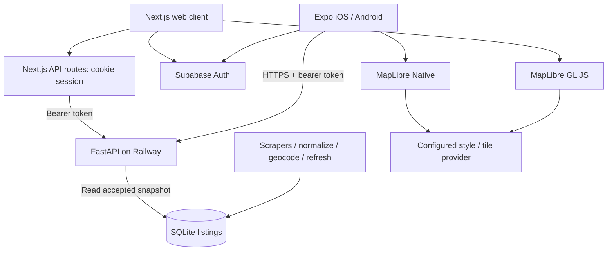

# Expo Mobile App Architecture

**Status:** Phases 1–4 implemented; Phase 5 private-beta preparation added; iOS/physical-device acceptance pending
**Date:** November 18, 2026
**Product:** IlliniRent / UIUC Housing Assistant
**Targets:** iOS and Android, alongside the existing Next.js website

## 1. Decision and goals

Add a React Native application built with Expo to this repository. Keep the Next.js website and the existing FastAPI, Supabase, and Python data pipeline. Extract platform-independent TypeScript into workspace packages consumed by both clients.

This is an architecture for a distributable native application. Simulators and emulators provide development previews; the same project produces builds for physical phones, TestFlight, Google Play testing, and eventual public store release. The mobile release can happen independently of the website.

Goals:

- Reuse search behavior and housing data without duplicating backend rules.
- Preserve the current website and its deployments during incremental adoption.
- Provide native browsing, filters, property details, and maps on both platforms.
- Keep platform differences behind explicit interfaces.
- Support a private beta before committing to a public release date.

Initial exclusions: replacing the website with Expo Web, native admin dashboards, push notifications, saved homes, a fully offline listing database, and browser-style HTML/image exports. These can be separate follow-up projects.

## 2. Current system and constraints

The proposal is grounded in the active source files, rather than archived Chat/RAG code.

| Area | Current implementation | Architectural implication |
|---|---|---|
| Data collection | `scrapers/` and `pipeline/` publish SQLite snapshots | Remains server-side and shared |
| Search | `backend/main.py` implements filters, sorting, pagination, and status | Keep search semantics here |
| Backend authentication | Supabase JWT verification through JWKS | Mobile can send bearer tokens directly |
| Web requests | `frontend/lib/api.ts` calls relative `/api/*` URLs | Extract serialization; inject transport configuration |
| Web API gateway | Next.js listing route reads cookies and forwards a token | Retain for web; bypass for mobile listing requests |
| Filter state | `frontend/contexts/FiltersContext.tsx` uses React state/context | Reusable with platform-neutral imports |
| Login | Email OTP and Google OAuth in `LoginCard.tsx` | Share validation; implement native session/callback handling |
| Maps | `react-map-gl`, MapLibre GL JS, OpenFreeMap | Native renderer required; style compatibility needs testing |
| Analytics | `/api/events` uses a cookie-authenticated Next.js route | Requires a bearer-authenticated mobile ingestion path |
| Exports | DOM, WebGL, `html-to-image`, and browser downloads | Keep web implementation separate |

The current README describes approved-user access, while the active login component describes open registration for allowed email domains. Before mobile beta, verify the deployed Supabase signup hook and launch settings. Mobile must follow server-enforced eligibility, not introduce a separate client-only policy.

## 3. Runtime architecture



Clients render results and own presentation state. FastAPI remains authoritative for filtering and sorting. Supabase remains authoritative for identity and signup eligibility. Neither client reads snapshot files directly.

The website continues on Vercel. Mobile builds contain their UI and call the existing services over HTTPS; they do not host Next.js or Python on the device.

## 4. Repository and package boundaries

```text
frontend/                       Existing Next.js app, kept in place
mobile/
  app/                          Expo Router route files
  src/
    features/                   Browse, filters, details, map, auth
    components/                 Native reusable UI
    providers/                  Session, query cache, filters
    adapters/                   Storage, API configuration, analytics
  assets/                       Native asset mappings
  app.config.ts                 Bundle IDs, plugins, environment config
  eas.json                      Development, preview, production profiles
packages/
  core/                         Domain types, options, pure utilities
  api-client/                   HTTP client, query serialization, API errors
  search-state/                 Platform-independent React filter provider
  design-tokens/                Colors, spacing, typography definitions
backend/                        Existing FastAPI service
pipeline/                       Existing pipeline
scrapers/                       Existing collection jobs
```

Use npm workspaces initially. Introduce a root lockfile through a deliberate migration from the current frontend installation, and update CI/Vercel installation settings together. Keep Python dependency management unchanged. Expo supports workspace-based monorepos; custom Metro configuration should only be added for demonstrated needs. [Expo monorepo guide](https://docs.expo.dev/guides/monorepos/)

Choose a supported Expo SDK at implementation time and use its compatible React Native and React versions. Audit the existing Next.js React version before installing: shared React packages must resolve the appropriate peer dependency in each app, without duplicate React instances within either bundle. Avoid broad dependency upgrades as part of extraction.

Boundary rules:

- `core` has no React, Next.js, native modules, environment reads, or filesystem access.
- `api-client` depends on `core` and accepts configuration; it never imports a Supabase singleton.
- `search-state` depends on React and `core`, with React declared as a peer dependency.
- Apps depend on packages; packages never import app code.
- Server Supabase clients, service-role credentials, and admin helpers remain server-only.
- Design tokens describe values; native and CSS adapters apply them separately.

Company names and coverage notes can move into `core`. Current logo paths such as `/logos/...` cannot be used unchanged on a phone: use shared asset keys with web URL and native bundled-asset mappings. Load Inter and Lilita One through native font loading rather than `next/font`.

## 5. Shared data contract and transport

Extract `Listing`, `Filters`, `ListingSort`, `ListingsPage`, `DataStatus`, defaults, and query serialization from `frontend/lib/api.ts`. Export availability helpers, landmark coordinates, and filter option values from `core`. Keep bed-group, price-tolerance, availability matching, and SQL sorting behavior in FastAPI.

The API client accepts:

```ts
type ApiClientOptions = {
  baseUrl: string;
  getAccessToken?: () => Promise<string | null>;
};
```

Web supplies the same-origin Next.js API base and uses its cookies. Mobile supplies the public FastAPI base URL and obtains the current Supabase access token for each request. Preserve repeated `beds` and `company` query parameters and existing response shapes. Support cancellation, bounded request timeouts, and structured errors that distinguish unauthorized, network, and server failures.

| Endpoint | Mobile use |
|---|---|
| `GET /api/status` | Public counts and freshness metadata |
| `GET /api/listings` | Authenticated browse and map data; same filters as web |
| Proposed `POST /api/events` on FastAPI | Authenticated mobile activity ingestion before beta |

Do not point mobile listing requests at the existing cookie-only Next.js route. Do not require CORS changes merely for native HTTP; browser CORS settings still matter to the website.

Add response contract validation at the client boundary and fixtures from representative backend responses. Reconcile nullability with actual output before extraction, especially nullable database fields. Additive backend fields remain backward compatible. Breaking changes need a versioned endpoint or explicit compatibility period because installed mobile binaries can remain in use after backend deployment.

### Listing identity and detail navigation

The current listing payload has no stable listing ID or detail endpoint. For v1, selecting a result opens detail content from the current search cache; the route selection key is session-local and is not a public share identifier. A cold start does not promise to restore that selection.

Before durable listing links or saved homes, add a stable backend ID that survives snapshot refreshes and a lookup endpoint with a defined removed-listing response. Do not use list indices, addresses alone, or assume source URLs uniquely identify units.

## 6. State, fetching, and persistence

Use the shared React filter provider for the selected filters across Browse and Map. Keep temporary sheet edits local until Apply; Cancel retains the applied values. Keep selected listing, map camera, and sheet visibility in feature state.

Use TanStack Query in mobile for server state, subject to Expo dependency verification during setup. Query keys include the normalized applied filters, sort, and pagination. Preserve repeated-filter semantics while normalizing array order for cache keys. Cancel obsolete requests when filters change so late responses cannot overwrite current results.

- Browse uses the existing paginated endpoint and a native `FlatList`.
- Map initially uses the existing all-results endpoint and native GeoJSON layers/clustering. Measure payload and rendering performance before adding viewport queries or a lightweight map endpoint.
- Cache data in memory for the first release. On reconnect or foreground resume, refetch when stale.
- Clear user-scoped caches and selected details on logout/account changes.
- Display dataset freshness separately from network fetch time: downloading an old snapshot does not make housing data fresh.
- Persist optional preferences using AsyncStorage. Do not persist listing data or tokens through that preference adapter.

The first release requires connectivity. Cached results may remain visible during transient failures with a clear refresh/error state; full offline search is outside scope.

## 7. Authentication and authorization

Implement a native Supabase client using `@supabase/supabase-js`; the web `@supabase/ssr` cookie client is not portable to native.

1. Restore the session before resolving protected navigation.
2. Support the existing email-code flow first, retaining server-side allowed-domain enforcement.
3. Persist the native session through a tested secure storage adapter. If using Expo SecureStore, verify full serialized session size and failure handling; do not assume arbitrarily large values are supported.
4. Tie token auto-refresh to native foreground/background state, following Supabase guidance. [Supabase React Native authentication](https://supabase.com/docs/guides/auth/quickstarts/react-native)
5. Obtain a fresh session token for authenticated API requests. On 401, coordinate at most one refresh/retry; repeated failure returns to login without a retry loop.
6. Logout clears local auth state and user caches, even when remote sign-out encounters a network failure.

The native navigation guard improves UX; FastAPI JWT verification enforces access. Production and preview backends must have `DEV_MODE=false`.

Add Google OAuth after email login works. Configure app identifiers, callback scheme, Supabase redirect allowlist, PKCE exchange, and cold/warm callback handling. Never reuse `window.location.origin` or the web cookie callback. Test on installed development builds. [Expo OAuth guidance](https://docs.expo.dev/guides/authentication/)

Before store submission, review the chosen login providers, account-deletion experience, and current platform requirements. Treat these as release work with a concrete implementation decision, rather than assuming web login parity completes native release readiness.

## 8. Native screens and navigation

```text
Root: session restoration / fonts / error boundary
  Auth: email entry → code verification
  Main tabs:
    Browse: result list → property detail
    Map: map → selected-property preview → property detail
  Shared filter sheet
  Settings / account: identity, logout, support, privacy
```

Use Expo Router for navigation. A common detail component serves Browse and Map; adapt its container for phone and tablet. Support Android back navigation, safe areas, keyboard avoidance, screen-reader labels, and larger text. Use the current warm palette and branded fonts with native layouts and touch targets.

External property and brochure links open through native browser/linking APIs with URL validation and failure feedback. Native image loading includes placeholders and broken-photo fallback; relative web image-proxy URLs must not leak into mobile without an explicit absolute-URL adapter.

Admin pages and the public About/marketing experience remain on the website. A phone-like computer preview is a demonstration of this real app, not a separate product architecture.

## 9. Maps and travel-time services

Use `@maplibre/maplibre-react-native` as the first candidate. It requires its Expo config plugin and a rebuilt development client; Expo Go cannot run this library. [MapLibre Expo setup](https://maplibre.org/maplibre-react-native/docs/setup/expo/)

Run a compatibility spike before investing in detailed map UI:

- Verify the selected Expo SDK/React Native combination on physical iOS and Android devices.
- Verify OpenFreeMap style, sprites, glyphs, tile access, attribution, and production usage conditions.
- Test marker selection, clustering, camera bounds, missing coordinates, and representative full-dataset performance.
- Adapt theme tokens to native style APIs; do not import GL JS event handlers or DOM markers.

If this fails, evaluate `react-native-maps` and document the provider, styling, and configuration tradeoffs before switching. Campus coordinates do not require device location permission. Add location permission only when implementing an explicit user-location feature.

Travel-time sorting currently calls OpenRouteService from `frontend/lib/osrm.ts` with a public web key. Keep it out of the initial mobile milestone. If added, introduce an authenticated backend routing adapter with protected credentials, request-size limits, caching, quotas, and timeout handling. Reuse coordinate transformation helpers, not the existing environment-coupled client unchanged.

## 10. Analytics, configuration, and operations

Before beta, implement bearer-authenticated event ingestion on FastAPI or another explicitly selected server endpoint. Validate supported event names and metadata sizes, derive user identity from verified JWTs, preserve admin-account exclusion, and keep database privileges server-side. Match existing event semantics and add `platform` and app-version fields. Analytics failure never blocks browsing. Do not send tokens or OTP values to logs.

Mobile public configuration includes the API base URL, Supabase URL/publishable key, and non-secret app settings. `EXPO_PUBLIC_*` values are bundled and readable by users. Service-role keys and private routing credentials belong only on servers.

Provide development, preview, and production build profiles with explicit service targets. Use a separate Supabase project for isolated preview data when feasible; otherwise document that preview auth can affect production accounts. Physical phones use a reachable LAN backend address or HTTPS development endpoint; `localhost:3101` points at the phone itself.

Measure request failures, auth restoration failures, crashes, map failures, and backend latency with app/build versions. Select a crash-reporting service during beta setup. Keep operational data-refresh monitoring in the existing pipeline; mobile displays the same freshness status as web.

## 11. Builds, deployment, and compatibility

Use Expo development builds from the start. Define separate app identifiers where preview and production need to coexist. Keep native configuration in Expo config/plugins, avoiding manual generated-native-project edits unless required and documented.

Delivery stages:

1. Simulator/emulator builds for quick UI iteration and demonstrations.
2. Installed development builds on physical devices for auth and maps.
3. Preview/private beta through internal Android distribution and TestFlight as appropriate.
4. Production signed binaries submitted to the stores when release readiness is met.

EAS Build/Submit is the proposed build and submission path; local native builds remain an option. Store submission and public availability are separate steps. [Expo production build guide](https://docs.expo.dev/deploy/build-project/)

Over-the-air updates are optional after beta. If adopted, isolate channels and require runtime compatibility; native dependency/configuration changes require a new binary. Keep a known-good build/update available for rollback. Backend changes must support installed older clients throughout the chosen compatibility window.

## 12. Implementation phases and acceptance gates

| Phase | Work | Completion gate |
|---|---|---|
| 1. Shared foundation | Workspaces, contract fixtures, extract core/client/state, update web imports | Web build/checks pass; representative filter requests retain their semantics |
| 2. Native feasibility | Expo shell, email OTP, session restoration, direct API call, minimal MapLibre map | Real iOS and Android devices authenticate, resume sessions, and render tiles |
| 3. Browse workflow | Filters, sorting, paginated list, shared detail content, image/error states | Search behavior matches web for the same snapshot and filters |
| 4. Map workflow | Native markers/layers, clustering, selection, shared applied filters | Browse/Map transitions retain filters; missing coordinates and full dataset behave correctly |
| 5. Private beta | Analytics endpoint, crash reporting, device/accessibility checks, build profiles | TestFlight/Android testers complete login → search → detail → map without blocking defects |
| 6. Public release | Store metadata, privacy/account flows, signing, operational ownership | Approved production builds and compatibility/rollback plan are ready |

Do not make Google OAuth, custom map themes, exports, or travel-time sorting dependencies of the first authenticated browsing milestone.

## 13. Verification strategy

- Shared unit/contract checks: repeated query parameters, null filters, 5+ beds, ceiling-only price tolerance, availability windows, response parsing, and structured failures.
- API integration checks: valid/missing/expired tokens; filtered results and totals; pagination; compatibility with existing web proxy calls.
- Native workflow checks: OTP, cold-start restoration, background/resume refresh, logout, rapid filter changes, pagination, detail navigation, marker selection, and broken images.
- Device checks: physical iOS and Android, slow/offline transitions, font scaling, safe areas, keyboard, and Android back behavior.
- Regression checks: existing web typecheck/lint/build with pre-existing failures recorded separately; no changes to scraper outputs or publication behavior for this migration.

Map frame rate, memory, payload size, and time to first result should be measured using representative accepted snapshots during the feasibility and beta phases. Set numeric performance budgets from those measurements before beta sign-off.

## 14. Decisions still requiring implementation evidence

| Decision | Default | Resolution point |
|---|---|---|
| Expo SDK and dependency versions | Supported stable compatible set | Workspace setup |
| Native session storage | Secure adapter with session-size/error tests | Auth feasibility |
| Map renderer/provider | MapLibre Native; evaluate current tile/style provider | Map feasibility |
| Preview isolation | Separate backend/auth environment when feasible | Beta setup |
| Stable listing identifiers | Not required for session-local details; required for durable links/saved homes | Before either feature |
| Store login/account flows | Email OTP first; review Google and account management before submission | Release readiness |

The first deliverable is a real installed app that signs in, reads the existing protected API, and proves native map compatibility. Subsequent phases expand that foundation while the website continues operating independently.


## Phase 1 implementation notes — November 17, 2026

Workspace packages now provide core contracts/utilities, API transport, React filter
state, and design tokens. The website consumes these through compatibility adapters.
See `frontend/README.md` for installation, checks, and Vercel settings.

The active snapshot contains nullable bedroom counts, despite the previous web type
claiming `number`. The shared contract now represents this as `number | null` and
omits an unknown bedroom label. Existing price-selection fallback behavior is retained.

The native application, native auth/session storage, analytics ingestion, map spike,
and any durable listing ID work remain in later phases. No application deployment
or remote project settings were changed as part of extraction.


## Phase 2 implementation notes — November 17, 2026

`mobile/` now contains an Expo Router application with email OTP login, protected
navigation, secure session restoration, AppState-managed refresh, bounded auth
requests, logout, and a five-listing authenticated backend preview. Signup UX
validation is shared with web; server-side eligibility remains unchanged.

Expo SDK 57 / React Native 0.86 preserve the existing React 19.2.4 dependency.
The initial SDK 56 candidate was replaced after Expo Doctor identified a Hermes
memory regression. See `mobile/README.md` for precise setup, checks, and remaining
device acceptance steps. No native map implementation or Google OAuth is included
in this auth/backend milestone, and the Phase 2 map feasibility gate remains open.

Phase 2 verification: 13 mobile tests, 10 shared tests, three backend JWT tests,
web/mobile typechecking, web production build, both native bundle exports, and all
21 Expo Doctor checks pass. The Android development APK built and opened its login
screen in the Pixel 6 emulator. Live-account restart/refresh checks, physical devices,
and native iOS compilation remain acceptance work; no store release was performed.

November 18 follow-up: the initial emulator origin required a running local backend,
which caused listing failures after successful login when that server was stopped.
Mobile setup now defaults to the verified deployed HTTPS API. An existing real-account
session restored after an Android app restart and loaded 1,306 listings; authentication
and listing-service errors are now distinguished in the UI. Native maps and physical
iOS/Android acceptance remain separate work.


## Phase 3 implementation notes — November 18, 2026

The native app now provides paginated browsing, draft/apply filters, all existing
backend sort modes, and session-local property details. It consumes shared filter
state/options, API serialization, availability logic, and design tokens. Sort options
and price-range formatting were extracted to core and adopted by the web components.

TanStack Query is installed for in-memory pagination/caching. Query keys include
identity, normalized filters, and sort. Obsolete requests are cancelled; later-page
errors preserve loaded results. Protected navigation owns the cache and selection,
so leaving the account clears them. Native details preserve browse state on return;
missing cold-start selections show a recovery screen. No stable IDs, snapshot schema,
backend search semantics, or website routes were changed.

Twenty-five mobile tests, ten shared tests, web/mobile typechecking, the website
production build, both native bundle exports, and all 21 Expo Doctor checks pass.
Website lint retains its existing three errors and 18 warnings. See `mobile/README.md`
for implementation details and the manual acceptance checklist.

Phase 3 live Android acceptance also passed after user sign-in: two-bed/$900
filter results matched the backend (238), draft Cancel preserved applied filters,
both price sort directions worked, a 25-result query loaded both server pages,
and returning from details preserved search state and end-of-list scroll position.
The default browse view was restored after testing. Physical devices and iOS remain
outside this emulator validation.


November 18 UI revision: per user preference, full-page filter and sort sheets were
replaced by anchored dropdown popovers over the listing results. All categories are
visible as toolbar chips. Single selections apply on tap; beds/managers support
immediate multi-select with Done; only budget amounts retain a validated Apply step.
Dismissal and keyboard handling keep this interaction within the browse context.


## Phase 4 implementation notes — November 18, 2026

Native Browse/Map tabs now share one account-scoped provider and the same header,
filter dropdowns, and authenticated transport. Map uses the existing all-results
endpoint, canonical filter keys, cancellation, and a separate in-memory query cache;
Browse pagination and sorting remain independent. MapLibre Native 11.5.1 and its
Expo plugin render OpenFreeMap Positron with native clustering, price pins, shared
campus landmarks, camera controls, attribution, and selection previews. Coincident
coordinates group all matching floor plans; missing coordinates remain in Browse.

Property details remain in the parent stack. Map selections use the existing
session-local record and return to the active map with its filters/camera retained.
No stable listing IDs, snapshot changes, backend filter duplication, user-location
permissions, or new provider API keys were introduced.

The Android client was rebuilt and real tiles/pins rendered for 1,306 listings at
599 locations. Shared filters were verified in both directions at 238 results
(two beds, $900) and 25 results (two beds, $550). Cluster expansion and location
previews worked on the emulator. All 32 mobile tests, 10 shared tests, typechecks,
web build, native bundle exports, and 21 Expo Doctor checks pass. Native iOS and
physical-device performance/reliability remain acceptance gates.

Node 24 LTS is selected in `.nvmrc` and CI because a MapLibre style dependency
requires Node 22+. Existing direct web dependency versions are unchanged. See
`mobile/README.md` for installation/rebuild instructions and remaining release checks.

The final live navigation check opened a map listing’s property details and returned
to the same selected location preview with its filters and result count retained.

## Phase 5 implementation notes — November 18, 2026

Mobile usage telemetry now uses the planned FastAPI bearer-authenticated
`POST /api/events`. It validates event names and bounded metadata, derives identity
from verified claims, excludes server-configured admin emails, rate-limits writes,
and forwards under the caller's Supabase JWT and existing insert RLS policy. No
service-role key is needed. The endpoint defaults to disabled pending deployment
configuration; the website's cookie-based analytics route remains unchanged.

Sentry native/JS integration, source-map build hooks, conservative event redaction,
a root error boundary, preview diagnostics, internal/store beta profiles and a
configuration preflight are implemented. Development never sends telemetry. No
remote Sentry/EAS project, backend deployment, signing setup or tester distribution
has been performed. See [private beta readiness](private-beta-readiness.md) for
setup, evidence and the remaining release gates; Phase 5 acceptance is not complete
until configured release artifacts pass those checks on real iOS/Android devices.
